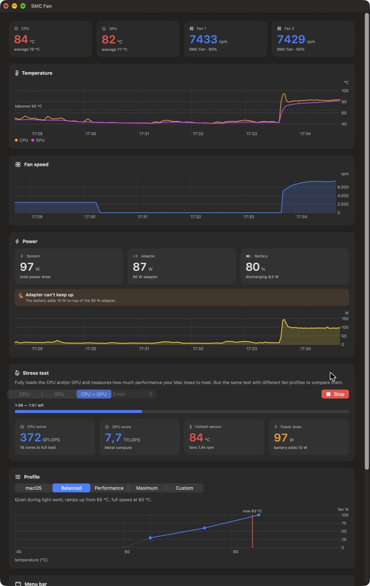
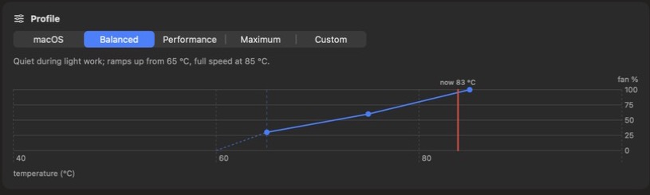
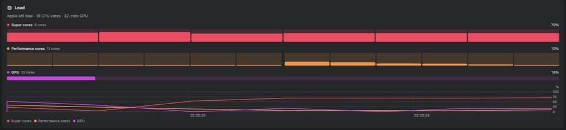
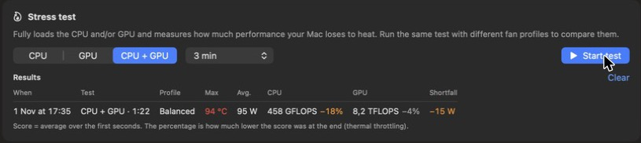
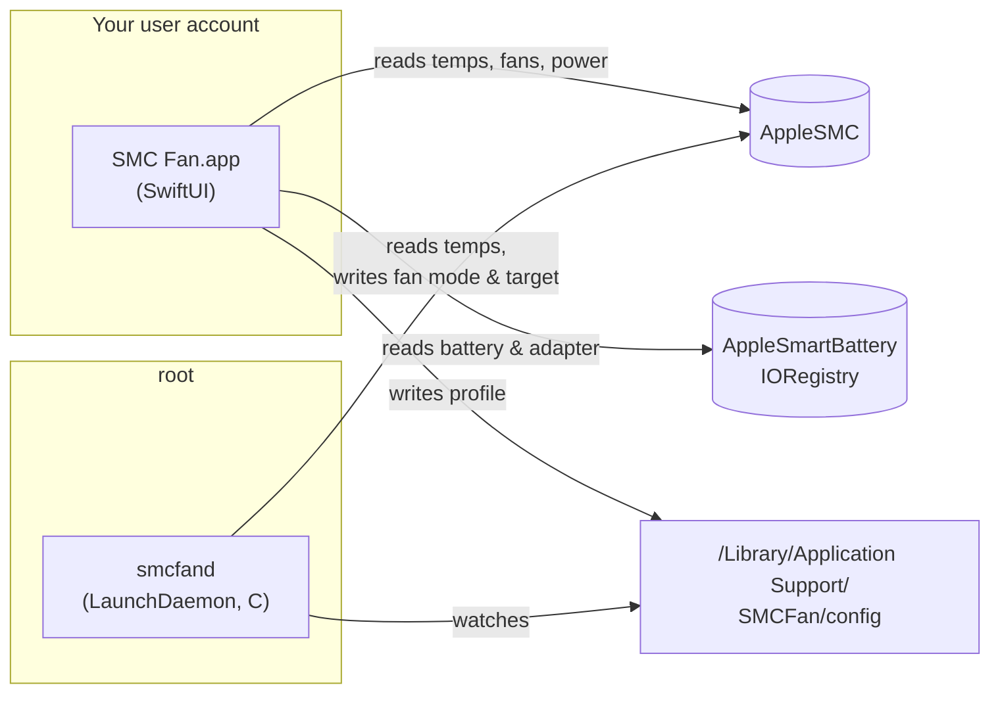

<p align="center">
  
</p>

<h1 align="center">SMC Fan</h1>

<p align="center">
  <b>Fan control, temperatures, power and a stress test for Apple Silicon MacBooks — right in your menu bar.</b><br>
  Lightweight, open source, written in C and SwiftUI.
</p>

<p align="center">
  <a href="https://github.com/joellopulalan-coder/SMC/actions/workflows/build.yml"></a>
  <a href="https://github.com/joellopulalan-coder/SMC/releases/latest"></a>
  
  
  <a href="LICENSE"></a>
</p>

<p align="center">
  🇬🇧 English · <a href="README.nl.md">🇳🇱 Nederlands</a>
</p>

<p align="center">
  
</p>

---

macOS keeps the fans of a MacBook Pro quiet for as long as it can and lets the chip get hot first. That's a fine default, but under sustained load (rendering, exports, compiling, local AI models) the chip throttles before the fans really spin up. **SMC Fan** lets you decide when the fans take over and how hard they run, shows you what your Mac is doing, and measures what it buys you.

It was born out of a simple question — *"why pay $10 for a fan app when we can build one?"* — and grew into a complete, free alternative.

## Contents

- [Features](#features)
- [Compatibility](#compatibility)
- [Installation](#installation)
- [Using SMC Fan](#using-smc-fan)
- [How it works](#how-it-works)
- [Command-line tool](#command-line-tool)
- [Resource usage](#resource-usage)
- [Files on your Mac](#files-on-your-mac)
- [Uninstalling](#uninstalling)
- [Safety](#safety)
- [Troubleshooting & FAQ](#troubleshooting--faq)
- [Contributing](#contributing)
- [Roadmap](#roadmap)
- [License](#license)

## Features

**Fan control**
- **Five profiles**: *macOS* (Apple's own control), *Balanced*, *Performance*, *Maximum* and *Custom*.
- **Custom curve editor** with a takeover threshold and three curve points, previewed live on a chart.
- **Hysteresis and smoothing**: SMC Fan takes over at the threshold and hands the fans back to macOS 5 °C lower, using a smoothed temperature, so the fans don't pump up and down.
- **Smooth ramp-down**: after a load spike the fans glide back to their minimum speed instead of hanging at the first curve point.
- **Survives sleep and restarts**: settings are re-applied every cycle, and the fans always go back to macOS when the service stops.

**Monitoring**
- **Per-core load**, grouped by core type and cluster — Super, Performance and Efficiency cores, whatever your chip has — plus GPU utilization and a load-history chart. The layout is read from macOS, so it fits every M-series chip from M1 to Ultra.
- CPU and GPU temperatures (hottest and average across ~100 on-die sensors), both fans, and 5 minutes of history on charts.
- **Power**: total system power, adapter input, adapter rating, battery percentage and charge/discharge rate.
- **Adapter shortfall warning**: a ⚡︎⚠︎ icon plus the deficit (e.g. `−16 W`) in the menu bar when your Mac draws more than the adapter can deliver and the battery has to help out.

**Menu bar**
- Pick what's shown next to the icon: temperature, fan speed, CPU load, GPU load, profile icon, power draw, charging/discharging and battery percentage — for example `48° · 2.4k rpm · CPU 23% · 15 W · AC`.
- A compact panel with temperatures, a per-core load strip, fans, power and a one-click profile switcher.

**Stress test & benchmark**
- Loads the CPU (all cores), the GPU (Metal compute) or both, for 1, 3 or 10 minutes or until you stop it.
- Live CPU score (GFLOPS) and GPU score (TFLOPS), temperature, fan speed and power.
- Results table with **thermal throttling**: how much lower the score was at the end than at the start. Run the same test with different profiles to see what your fan settings are worth.

**Built to stay out of the way**
- About **1% CPU and 50 MB** while running in the menu bar; the background service uses **~0.2% CPU and under 2 MB**. See [Resource usage](#resource-usage).
- Available in **English and Dutch**, following your macOS language.
- A command-line tool (`smcfan`) for status, scripting and hardware reports.

## Compatibility

| Mac | Status |
|---|---|
| MacBook Pro 14" M5 Max (Mac17,7) | ✅ Developed and tested on this machine |
| Other M5-generation MacBook Pros | 🟢 Expected to work (same `F*md` fan keys) |
| M1 – M4 MacBook Pros | 🟡 Experimental: uses the older `F*Md` key and the `Ftst` unlock; please [send a hardware report](https://github.com/joellopulalan-coder/SMC/issues/new?template=hardware_report.yml) |
| MacBook Air (no fans) | 🔵 Monitoring, power and stress test only |
| Intel Macs | ❌ Not supported (different SMC layout) |

Requires **macOS 15 Sequoia or later** and an **Apple Silicon** Mac. Developed on macOS 27.

## Installation

### Download

1. Download `SMC-Fan-<version>.zip` from the [latest release](https://github.com/joellopulalan-coder/SMC/releases/latest) and unzip it.
2. Move **SMC Fan.app** to your **Applications** folder.
3. Open it. Because the app is not notarized by Apple (that requires a paid developer account), macOS blocks the first launch:
   - open **System Settings → Privacy & Security**, scroll down and click **Open Anyway**, or
   - run this once in Terminal:
     ```bash
     xattr -dr com.apple.quarantine "/Applications/SMC Fan.app"
     ```
4. In the dashboard, click **Install** and enter your password. This installs the background service that controls the fans (see [How it works](#how-it-works)). Without it, SMC Fan can only monitor.
5. Optional: enable **Open SMC Fan at login** at the bottom of the dashboard.

Every release lists a SHA-256 checksum, so you can verify the download with `shasum -a 256 SMC-Fan-*.zip`.

### Build from source

You only need Apple's Command Line Tools — no Xcode project, no dependencies.

```bash
xcode-select --install
```
```bash
git clone https://github.com/joellopulalan-coder/SMC.git && cd SMC
```
```bash
./build.sh install
```

This builds `build/SMC Fan.app` and the `build/smcfan` command-line tool, and copies the app to `/Applications`. Building from source sidesteps Gatekeeper entirely.

## Using SMC Fan

### Profiles

| Profile | Takes over at | Curve | Back to macOS below |
|---|---|---|---|
| **macOS** | never | Apple's own fan control | — |
| **Balanced** | 65 °C | 30% → 60% at 75 °C → 100% at 85 °C | 60 °C |
| **Performance** | 55 °C | 40% → 70% at 65 °C → 100% at 75 °C | 50 °C |
| **Maximum** | always | both fans at full speed | — |
| **Custom** | your choice (45–85 °C) | three points you set | threshold − 5 °C |

Percentages are between the fan's minimum and maximum speed (on the M5 Max: 2,317–7,826 rpm). The temperature used is the hottest CPU or GPU sensor, smoothed over a few seconds.

While cooling down, the fans ramp from the first curve point back to their minimum speed between the takeover and release temperatures (the dashed line in the curve chart), and below the release temperature macOS takes over again.

<p align="center"></p>

### Load

The **Load** block shows one bar per CPU core, grouped by core type and, within a type, by cluster. Hover over a bar to see the core number and its load. Below it is the GPU's utilization and a chart with the average load per core type over time.

<p align="center"></p>

Which core types you see depends on your chip:

| Chip | Core types (fastest first) |
|---|---|
| M1 – M4 (Pro / Max / Ultra) | Performance · Efficiency |
| M5 | Super · Performance (the 14" M5 Max: 6 Super + 12 Performance in two clusters, no Efficiency cores) |

SMC Fan doesn't hard-code any of this: it reads the core types from macOS (`hw.perflevelN`) and maps each core to its type and cluster through the device tree, so new chips work without an update.

### Menu bar

Choose what appears next to the icon in **Dashboard → Menu bar**. The icon itself tells you what's going on:

| Icon | Meaning |
|---|---|
| fan (outline) | macOS controls the fans |
| fan (filled) | SMC Fan controls the fans |
| profile icon | you chose to show the active profile |
| 🔥 flame | a stress test is running |
| ⚡︎⚠︎ bolt with warning | the adapter can't keep up and the battery is helping out |

### Adapter shortfall warning

When your Mac is plugged in but the battery is discharging *and* the Mac draws more than the adapter delivers, SMC Fan shows the shortfall. On a 14" M5 Max with the 90 W adapter this happens when CPU and GPU are both fully loaded (~100 W). Short spikes are ignored: the warning appears after two readings in a row and disappears after two normal ones. Battery top-ups after a load (the battery briefly helping out at low power, or charging back up) don't trigger it.

### Stress test

Choose CPU, GPU or both and a duration, then press **Start test**. Afterwards a row is added to the results table (the last 10 are kept):

<p align="center"></p>

- **Score**: the average during seconds 3–10 of the test.
- **Percentage**: how much lower the score was during the last 20% of the test — that's thermal throttling. Example from the M5 Max: CPU −15% after one minute on *Performance*.
- **Shortfall**: the biggest adapter deficit during the test.

The CPU score counts fused multiply-adds on independent chains across all cores; the GPU score does the same in a Metal compute kernel. They're meant for comparing runs on the same Mac, not for comparing with other benchmarks.

## How it works

Changing fan speeds requires root, but a menu bar app shouldn't run as root. SMC Fan is therefore split in two:



- **The app** reads sensors directly from the SMC (reading needs no special rights), draws the UI and writes your profile to a small text file.
- **The daemon** (`smcfand`) runs as root under launchd. Every 2 seconds it reads the temperatures, smooths them, decides whether to take over, and sets fan mode (`F*md`) and target speed (`F*Tg`). It reloads the config file when it changes and holds an exclusive lock so only one instance can run.
- **Installing** uses the standard macOS password prompt to copy the daemon to `/Library/PrivilegedHelperTools` and register a LaunchDaemon. Updating the app shows an **Update** button when the bundled daemon differs from the installed one.

More detail in [docs/ARCHITECTURE.md](docs/ARCHITECTURE.md), and the SMC keys are documented in [docs/SMC.md](docs/SMC.md).

## Command-line tool

`smcfan` is the same binary as the daemon. It's built to `build/smcfan`, and the installed copy lives at `/Library/PrivilegedHelperTools/smcfand`.

```text
smcfan status               temperatures and fans (no root needed)
smcfan keys [prefix]        list readable SMC keys, e.g. "smcfan keys F" for all fan keys
sudo smcfan run             run the Balanced curve in the foreground; Ctrl-C hands the fans back
sudo smcfan daemon <config> what the LaunchDaemon runs
sudo smcfan auto            hand the fans back to macOS right away
smcfan version
```

Example:

```text
$ smcfan status
CPU  avg  47.4 °C  max  48.3 °C  (23 sensors)
GPU  avg  47.2 °C  max  47.5 °C  (84 sensors)
Fan 0  2316 rpm  (target 2317, range 2317-7826)  macOS
Fan 1  2498 rpm  (target 2502, range 2317-7826)  macOS
```

`run` and the daemon share a lock, so stop the background service (or remove it in the app) before using `run`.

## Resource usage

Measured on a 14" M5 Max running macOS 27, with two displays:

| | CPU | Memory |
|---|---|---|
| App, menu bar only | ~0.9% | ~50 MB |
| App, dashboard open | ~2–3% | ~200 MB |
| Background service | ~0.2% | < 2 MB |

How it stays light: the dashboard draws nothing while it's closed or fully covered; sensors are read every 5 s when only the menu bar is visible (2 s with the dashboard open); the menu bar item only redraws when its text actually changes; SMC key metadata is cached; and Metal is only loaded while a GPU test runs.

## Files on your Mac

| Path | What |
|---|---|
| `/Applications/SMC Fan.app` | The app |
| `/Library/PrivilegedHelperTools/smcfand` | The background service (root) |
| `/Library/LaunchDaemons/local.smcfan.plist` | Starts the service at boot |
| `/Library/Application Support/SMCFan/config` | Active profile, written by the app |
| `/var/log/smcfan.log` | Service log (takeovers, config reloads, errors) |
| `/var/run/smcfan.lock` | Lock held while the service runs |
| `~/Library/Preferences/local.smcfan.app.plist` | App settings and stress test results |

## Uninstalling

1. Open the dashboard, scroll to **Background service** and click **Remove** (asks for your password). The service stops and the fans go back to macOS.
2. Quit SMC Fan and move it to the Trash.
3. Optionally remove the leftovers:
   ```bash
   sudo rm -rf "/Library/Application Support/SMCFan" /var/log/smcfan.log
   ```
   ```bash
   defaults delete local.smcfan.app
   ```

If the app is already gone, remove the service by hand:

```bash
sudo launchctl bootout system/local.smcfan; sudo rm -f /Library/LaunchDaemons/local.smcfan.plist /Library/PrivilegedHelperTools/smcfand
```

## Safety

- SMC Fan only changes **fan mode and target speed**. It never touches voltages, power limits or firmware.
- Apple's own thermal protection keeps working no matter what you set: the chip throttles and, in the extreme, the Mac shuts down before it gets damaged.
- The fans **always go back to macOS** when the service stops, is removed or restarts, and when the temperature drops below the release threshold.
- The *Custom* profile lets you choose low fan speeds at high temperatures. That won't harm your Mac (see above), but it will throttle sooner — that's on you.
- The daemon runs as root and reads a config file that your user can write. It only accepts a handful of numeric settings, parsed with bounded `sscanf` calls. See [SECURITY.md](SECURITY.md).

This project is not affiliated with or endorsed by Apple. Use it at your own risk.

## Troubleshooting & FAQ

<details>
<summary><b>macOS says the app is damaged or can't be opened</b></summary>

The downloaded app isn't notarized. Use **Open Anyway** in System Settings → Privacy & Security, or remove the quarantine flag: `xattr -dr com.apple.quarantine "/Applications/SMC Fan.app"`. Or build it from source.
</details>

<details>
<summary><b>The dashboard says "Update available for the background service"</b></summary>

You installed a new version of the app; the installed service is still the old one. Click **Update** and enter your password.
</details>

<details>
<summary><b>The fans stay fast after closing everything</b></summary>

Check the log with `tail /var/log/smcfan.log`. You can always hand the fans back to macOS with:

```bash
sudo /Library/PrivilegedHelperTools/smcfand auto
```
</details>

<details>
<summary><b>The log says "The SMC refuses writes to the fans"</b></summary>

Your Mac uses fan keys SMC Fan doesn't know yet. Please open a [hardware report](https://github.com/joellopulalan-coder/SMC/issues/new?template=hardware_report.yml) with the output of `smcfan keys F` and `sysctl -n hw.model`.
</details>

<details>
<summary><b>The fans show 0 rpm</b></summary>

That's normal: when the Mac is cool, macOS stops the fans entirely.
</details>

<details>
<summary><b>Why does the battery discharge while the adapter is connected?</b></summary>

Either your Mac needs more power than the adapter delivers (SMC Fan then shows the shortfall warning), or macOS lets the battery briefly help out after a load. The battery current also lags a few seconds behind the actual load.
</details>

<details>
<summary><b>Does SMC Fan replace macOS's "High Power" energy mode?</b></summary>

No, they work well together. Energy mode (System Settings → Battery) controls how much power the chip may use; SMC Fan controls how the fans respond to the resulting heat.
</details>

## Contributing

Contributions are very welcome — especially **hardware reports from other Macs**, **translations** and bug fixes. See [CONTRIBUTING.md](CONTRIBUTING.md) for the development setup, the localization workflow and the PR checklist.

## Roadmap

- [ ] Hardware support confirmed on M1–M4 MacBook Pros
- [ ] Signed and notarized releases
- [ ] More languages
- [ ] Per-fan curves
- [ ] Desktop widget
- [ ] Automatic update check

## Acknowledgements

SMC Fan stands on the shoulders of earlier work on the Apple SMC, such as [smcFanControl](https://github.com/hholtmann/smcFanControl) and [Stats](https://github.com/exelban/stats), and was inspired by commercial tools like Macs Fan Control and TG Pro. No code was copied; the SMC interface was written from scratch and the keys were discovered on the M5 Max itself.

## License

[Apache License 2.0](LICENSE) © 2026 [joellopulalan-coder](https://github.com/joellopulalan-coder) and contributors
