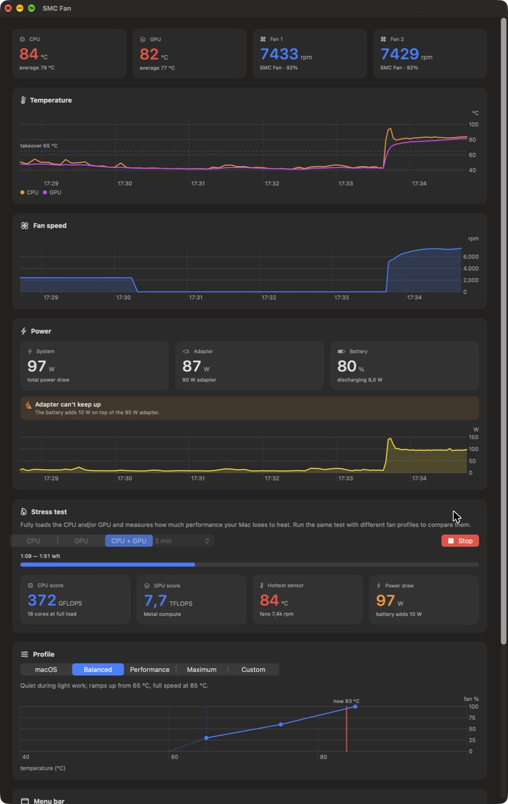

<p align="center">
  
</p>

<h1 align="center">SMC Fan</h1>

<p align="center">
  <b>Fanregeling, temperaturen, stroomverbruik en een stresstest voor Apple Silicon MacBooks — gewoon in je menubalk.</b><br>
  Lichtgewicht, open source, geschreven in C en SwiftUI.
</p>

<p align="center">
  <a href="README.md">🇬🇧 English</a> · 🇳🇱 Nederlands
</p>

<p align="center">
  
</p>

---

macOS houdt de fans van een MacBook Pro zo lang mogelijk stil en laat de chip eerst warm worden. Prima als standaard, maar bij langdurige belasting (renderen, exporteren, compileren, lokale AI-modellen) gaat de chip throttlen voordat de fans echt opspinnen. Met **SMC Fan** bepaal je zelf wanneer de fans het overnemen en hoe hard ze draaien, zie je wat je Mac doet, en meet je wat het oplevert.

Het begon met een simpele vraag — *"waarom $10 betalen voor een fan-app als we er zelf een kunnen bouwen?"* — en groeide uit tot een compleet, gratis alternatief.

## Functies

**Fanregeling**
- **Vijf profielen**: *macOS* (Apple's eigen regeling), *Gebalanceerd*, *Prestatie*, *Maximaal* en *Aangepast*.
- **Eigen curve** met overnamedrempel en drie punten, live in een grafiek.
- **Hysterese en demping**: SMC Fan neemt over bij de drempel en geeft de fans 5 °C lager terug aan macOS, op basis van een afgevlakte temperatuur. Zo pompen de fans niet op en neer.
- **Soepel afbouwen**: na een piek zakken de fans geleidelijk naar het minimum in plaats van te blijven hangen.
- **Bestand tegen slaapstand en herstarts**: instellingen worden elke ronde opnieuw gezet, en de fans gaan altijd terug naar macOS als de dienst stopt.

**Monitoring**
- CPU- en GPU-temperaturen (heetste en gemiddelde over ~100 sensoren op de chip), beide fans, en 5 minuten geschiedenis in grafieken.
- **Stroom**: totaal systeemverbruik, wat de adapter levert, het adaptervermogen, batterijpercentage en laad- of ontlaadvermogen.
- **Waarschuwing bij een tekort**: een ⚡︎⚠︎-icoon plus het tekort (bijv. `−16 W`) in de menubalk als je Mac meer trekt dan de adapter kan leveren.

**Menubalk**
- Kies wat er naast het icoon staat: temperatuur, fansnelheid, profiel-icoon, stroomverbruik, laden/ontladen en batterijpercentage, bijvoorbeeld `48° · 2,4k rpm · 15 W · AC`.
- Een compact paneel met temperaturen, fans, stroom en een profielkeuze met één klik.

**Stresstest & benchmark**
- Belast de CPU (alle cores), de GPU (Metal compute) of beide, 1, 3 of 10 minuten of tot je stopt.
- Live CPU-score (GFLOPS) en GPU-score (TFLOPS), temperatuur, fansnelheid en verbruik.
- Resultatentabel met **thermal throttling**: hoeveel lager de score aan het eind was. Draai dezelfde test met verschillende profielen om te zien wat je fan-instellingen waard zijn.

**Licht en onopvallend**
- Ongeveer **1% CPU en 50 MB** in de menubalk; de achtergronddienst gebruikt **~0,2% CPU en minder dan 2 MB**.
- In het **Engels en Nederlands**, volgens de taal van macOS.
- Een command-line tool (`smcfan`) voor status, scripts en hardware-rapporten.

## Geschikt voor

| Mac | Status |
|---|---|
| MacBook Pro 14" M5 Max (Mac17,7) | ✅ Ontwikkeld en getest op deze machine |
| Andere MacBook Pro's met M5-chip | 🟢 Werkt naar verwachting (zelfde `F*md`-fansleutels) |
| MacBook Pro's met M1 – M4 | 🟡 Experimenteel: gebruikt de oudere `F*Md`-sleutel en de `Ftst`-ontgrendeling; [stuur een hardware-rapport](https://github.com/joellopulalan-coder/SMC/issues/new?template=hardware_report.yml) |
| MacBook Air (geen fans) | 🔵 Alleen monitoring, stroom en stresstest |
| Intel-Macs | ❌ Niet ondersteund |

Vereist **macOS 15 Sequoia of nieuwer** en een Mac met **Apple Silicon**.

## Installeren

### Downloaden

1. Download `SMC-Fan-<versie>.zip` van de [nieuwste release](https://github.com/joellopulalan-coder/SMC/releases/latest) en pak het uit.
2. Zet **SMC Fan.app** in je map **Apps**.
3. Open de app. Omdat hij niet door Apple genotariseerd is (daarvoor is een betaald ontwikkelaarsaccount nodig), blokkeert macOS de eerste keer:
   - ga naar **Systeeminstellingen → Privacy en beveiliging**, scroll naar beneden en klik op **Open toch**, of
   - voer dit één keer uit in Terminal:
     ```bash
     xattr -dr com.apple.quarantine "/Applications/SMC Fan.app"
     ```
4. Klik in het dashboard op **Installeren** en voer je wachtwoord in. Dit installeert de achtergronddienst die de fans aanstuurt. Zonder die dienst kan SMC Fan alleen meekijken.
5. Optioneel: zet **SMC Fan openen bij inloggen** aan, onderaan het dashboard.

### Zelf bouwen

Je hebt alleen Apple's Command Line Tools nodig.

```bash
xcode-select --install
```
```bash
git clone https://github.com/joellopulalan-coder/SMC.git && cd SMC
```
```bash
./build.sh install
```

## Profielen

| Profiel | Neemt over vanaf | Curve | Terug naar macOS onder |
|---|---|---|---|
| **macOS** | nooit | Apple's eigen regeling | — |
| **Gebalanceerd** | 65 °C | 30% → 60% bij 75 °C → 100% bij 85 °C | 60 °C |
| **Prestatie** | 55 °C | 40% → 70% bij 65 °C → 100% bij 75 °C | 50 °C |
| **Maximaal** | altijd | beide fans vol | — |
| **Aangepast** | zelf te kiezen (45–85 °C) | drie eigen punten | drempel − 5 °C |

De percentages liggen tussen het minimum- en maximumtoerental van de fan (bij de M5 Max 2.317–7.826 rpm). De gebruikte temperatuur is de heetste CPU- of GPU-sensor, afgevlakt over een paar seconden.

## Hoe het werkt

Fans aansturen vereist root-rechten, maar een menubalk-app hoort niet als root te draaien. Daarom bestaat SMC Fan uit twee delen:

- **De app** leest de sensoren direct uit de SMC (lezen mag zonder speciale rechten), tekent de interface en schrijft je profiel naar een klein tekstbestand.
- **De dienst** (`smcfand`) draait als root via launchd. Elke 2 seconden leest hij de temperaturen, vlakt ze af, beslist of hij overneemt, en zet de fanmodus (`F*md`) en het doeltoerental (`F*Tg`).

Meer details staan (in het Engels) in [docs/ARCHITECTURE.md](docs/ARCHITECTURE.md) en [docs/SMC.md](docs/SMC.md).

## Verwijderen

1. Open het dashboard, scroll naar **Achtergronddienst** en klik op **Verwijderen**. De dienst stopt en de fans gaan terug naar macOS.
2. Sluit SMC Fan en gooi de app in de prullenmand.
3. Optioneel de restjes opruimen:
   ```bash
   sudo rm -rf "/Library/Application Support/SMCFan" /var/log/smcfan.log
   ```

## Veiligheid

- SMC Fan verandert alleen de **fanmodus en het doeltoerental**. Nooit spanningen, stroomlimieten of firmware.
- Apple's eigen thermische beveiliging blijft altijd werken: de chip throttlet en in het uiterste geval schakelt de Mac uit voordat er schade ontstaat.
- De fans gaan **altijd terug naar macOS** als de dienst stopt, wordt verwijderd of herstart.

Dit project is niet verbonden aan Apple. Gebruik op eigen risico.

## Problemen?

- **"Update beschikbaar voor de achtergronddienst"**: je hebt een nieuwe app-versie; klik op **Bijwerken**.
- **Fans blijven hard draaien**: kijk in het log met `tail /var/log/smcfan.log`, of geef de fans direct terug aan macOS met `sudo /Library/PrivilegedHelperTools/smcfand auto`.
- **Fans staan op 0 rpm**: normaal; als de Mac koel is zet macOS de fans helemaal uit.

Meer antwoorden in de [Engelse README](README.md#troubleshooting--faq).

## Meedoen

Bijdragen zijn welkom, vooral **hardware-rapporten van andere Macs**, **vertalingen** en bugfixes. Zie [CONTRIBUTING.md](CONTRIBUTING.md).

## Licentie

[Apache License 2.0](LICENSE)
